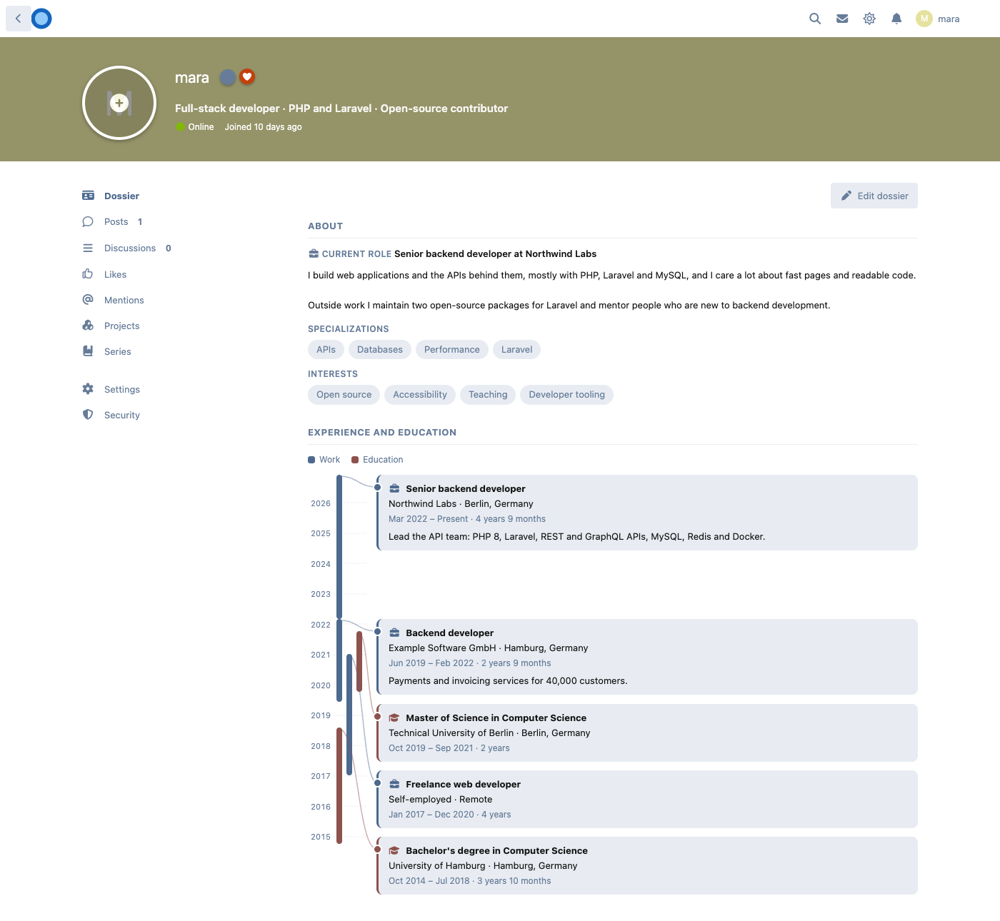
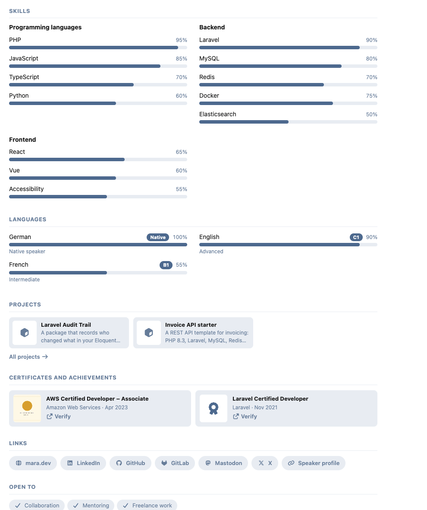
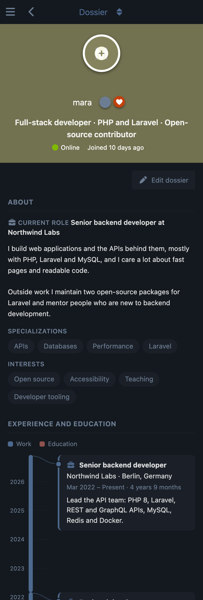

# Dossier

 [](https://packagist.org/packages/ernestdefoe/dossier)

A [Flarum](https://flarum.org) 2 extension that gives every member a professional profile: a light résumé and skills showcase for developer and professional communities. It adds a **Dossier** tab to the profile, first in the list.



- **About**: a one-line headline shown under the member's name, their current role, a bio in plain text, and short lists of specializations and interests.
- **Experience and education**: a vertical timeline drawn to scale. Each job or degree is a bar as long as it lasted, entries that overlap sit side by side, and work and education each have their own color.
- **Skills**: a level from 0 to 100 drawn as a bar, grouped by category. Members pick from a catalogue you keep, and can type their own when you allow it.
- **Languages**: the CEFR level (A1 to C2, or Native) and an optional percent bar.
- **Projects**: when [Projects](https://github.com/ernestdefoe/projects) is installed, the member's published projects as small cards that lead to their Projects tab.
- **Series**: when [Anthology](https://github.com/ernestdefoe/anthology) is installed, the series a writer has published (or novels, stories or books, whichever word the forum uses), with their covers and chapter counts, leading to their Series tab.
- **Finished builds**: when [Garage](https://github.com/ernestdefoe/garage) is installed, the builds a member has finished (newest first, up to six), with each cover, when it was finished and the specs its category shows on cards, leading to their Garage. Drafts never show, not even to the owner.
- **Certificates and achievements**: title, issuer, date, a verification link and an optional picture.
- **Links**: website, LinkedIn, GitHub, GitLab, X, Mastodon and any other link, each with its icon.
- **Open to**: chips such as collaboration, mentoring, freelance work and job offers. You choose the list.

Members edit their dossier on the page itself: **Edit dossier** adds, changes, deletes and reorders entries in each section.


| | |
|---|---|
|  |  |

## Private by design

- **Every section has its own visibility**: everyone, members, or only the member. Each link has one too, and is never shown more widely than its section.
- **Hidden parts are never sent.** The forum leaves them out of what it sends to the browser, so a guest's browser never holds a members-only section.
- **Only web addresses.** Links and verification links must start with `https://` or `http://`.
- **Pictures are re-encoded.** A certificate picture is converted to WebP under a random name, so the file that was uploaded is never stored or served, and its metadata (such as a phone photo's location) is gone. Uploads are limited to 4 MB and to ten a minute per member.

## Light by design

The Dossier page and its editor load only when someone opens a dossier. Every other page carries about 3 KB (gzipped) more than it did without Dossier, and Dossier adds nothing to the discussion, post and user lists. A dossier loads in one request with the same few queries whatever it holds.

## Installation

```sh
composer require ernestdefoe/dossier
php flarum migrate
php flarum cache:clear
```

## Updating

```sh
composer update ernestdefoe/dossier
php flarum migrate
php flarum cache:clear
```

## Settings

- **Open profiles on Dossier** (on by default): a member's profile opens on their dossier when it has something to show the viewer. Otherwise it opens on their posts, as before. While this is on, the posts are at `/u/username/posts`.
- **Members can add their own skills** (on by default): members can type a skill that isn't in the catalogue. Those skills are listed under **Skills members added**, where you can add them to the catalogue (in a category) or remove them.
- **Open to**: the chips members can pick. The four built-in ones are named in the forum's language until you rename them.
- **Skill catalogue**: categories and their skills. A new install starts with Programming languages, Backend and Frontend, which you can rename, change or remove.

## Permissions

- **View dossiers**: everyone after installing.
- **Have a dossier**: members after installing. Members without it can't fill in or edit their own dossier.
- **Edit any dossier**: moderators after installing. They can edit anyone's dossier, and see sections set to "Only me".

## Links

- [GitHub](https://github.com/ernestdefoe/dossier)
- [Packagist](https://packagist.org/packages/ernestdefoe/dossier)

☕ If you like the things I have built, consider [buying me a coffee](https://buymeacoffee.com/ernestdefoe).
